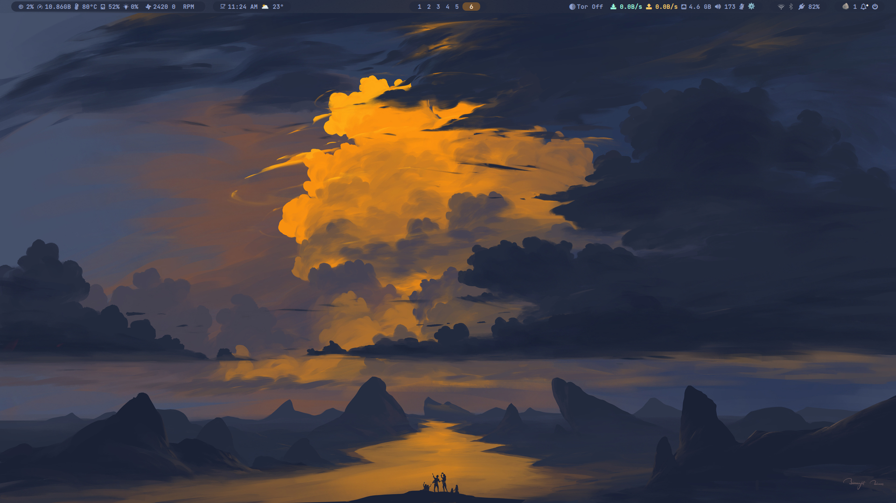
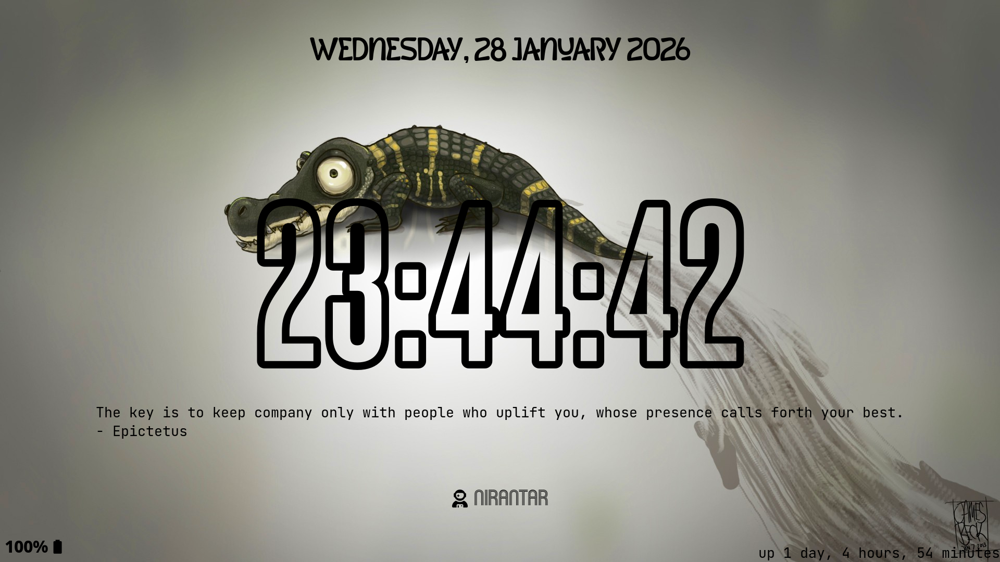
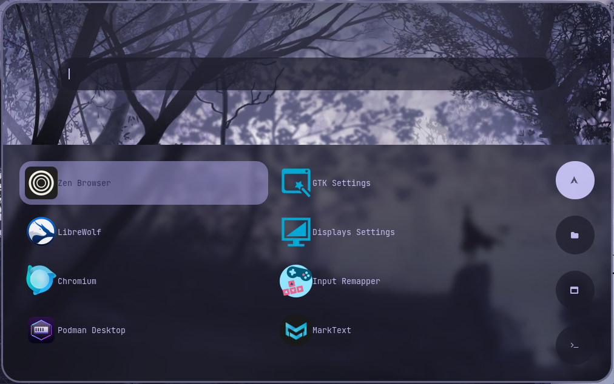

# HyDE - Hyprland Desktop Environment

A personal Hyprland setup for Arch Linux: dotfiles, helper scripts and an
installer that can set everything up from a fresh installation.

The dotfiles grew out of [HyDE](https://github.com/HyDE-Project/HyDE) and have
been heavily customised; see the "Credits" section.

## Features

- **Modular installation** – pick components with `--only` or answer prompts.
- **Idempotent installer** – safe to re-run; existing files are backed up.
- **Dotfiles** – Hyprland, Waybar, Dunst, Kitty, Rofi, Hyprlock, and more.
- **Themes** – Catppuccin GTK theme and Bibata cursors.
- **Tools** – Neovim/AstroNvim, pyprland, zoxide, fzf, and more.

## Screenshots






## Requirements

- Arch Linux (or an Arch-based distribution)
- An existing graphical session is **not** required, but the installer expects
  a normal user account with `sudo` rights.
- Network access (packages, fonts, wallpapers).

## Quick start

```bash
sudo pacman -S --needed git
git clone --depth 1 https://github.com/niru124/Hypr.git
cd Hypr
./install_all.sh
```

`install_all.sh` asks before each component. Useful flags:

```bash
./install_all.sh --help              # list components and options
./install_all.sh --yes               # non-interactive, accept everything
./install_all.sh --dry-run           # show what would run
./install_all.sh --only core,zsh     # run selected components only
```

After the installer finishes, log out and back in (or reboot) so the new shell
configuration, groups and services take effect.

## Components

| Component    | Script                     | What it does                                            |
| ------------ | -------------------------- | ------------------------------------------------------- |
| `core`       | `install_core.sh`          | pacman + AUR packages, dotfiles, helper scripts         |
| `zsh`        | `install_zsh.sh`           | Oh My Zsh, Powerlevel10k, plugins, `.zshrc`             |
| `wallpapers` | `install_wallpapers.sh`    | clones the wallpaper collection into `~/.config/hyde`  |
| `gpu`        | `install_gpu_drivers.sh`   | Mesa/NVIDIA userspace drivers for the detected GPU      |
| `fonts`      | `install_fonts.sh`         | Nerd Fonts, Noto emoji, display fonts                   |
| `pyprland`   | `pyprland.sh`              | pyprland from the AUR                                   |
| `greetd`     | `tui_greet.sh`             | configures tuigreet (run through sudo)                  |
| `astronvim`  | `install_astronvim.sh`     | AstroNvim configuration (previous config is backed up)  |
| `vim`        | `vim.sh`                   | `~/.vimrc`                                              |
| `tmux_keyd`  | `tmux_and_keyd.sh`         | tmux config, TPM and the keyd remapping                 |
| `themes`     | `install_themes.sh`        | GTK theme and cursor theme                              |
| `optional`   | `install_non_essential.sh` | optional packages, selected with fzf                    |

Every script can also be run on its own, e.g. `./install_fonts.sh`.

`install_hyprpm_plugins.sh` is **not** part of the default flow: Hyprland 0.56
and newer ship a native `scrolling` layout that supersedes the old
`hyprscroller` plugin. Run it manually only if you know you need the plugin.

## Layout

```
.
├── install_all.sh          # entry point
├── install_*.sh            # components
├── lib/common.sh           # shared helpers (logging, backups, packages)
├── pacman_necessary.txt    # official-repo packages
├── yay_necessary.txt       # AUR packages
├── non-essential.txt       # optional packages
├── Config/.config/         # dotfiles, copied to ~/.config
├── bin2/                   # helper scripts, copied to ~/.local/share/bin
├── assets/                 # screenshots
└── themes/                 # GTK theme and cursor theme archives
```

## Notes

- Dotfiles are copied with `rsync`, and every file that would be overwritten is
  saved under `~/.config-backup/<timestamp>/` (a `latest` symlink points to the
  most recent backup).
- Shell dotfiles are backed up the same way before being replaced.
- Private or machine-specific files (`.zshrc` history, caches) are ignored via
  `.gitignore`.
- `greetd` is **enabled** but not started, so the installer can be run from a
  live desktop session without terminating it. Reboot to use the greeter.

## Keybindings and usage

- Hyprland keybindings: `Config/.config/hypr/hyprland.conf`.
- Waybar modules: scripts in `~/.local/share/bin/` (added to `PATH` by
  `.zshrc`).
- Wallpapers: the `wall` script, stored in `~/.config/hyde/themes/`.
- Lock-screen quotes: `quotes.json`.

## Credits

- [HyDE](https://github.com/HyDE-Project/HyDE) – the original project these
  dotfiles are based on.
- [AstroNvim](https://github.com/AstroNvim/AstroNvim),
  [Powerlevel10k](https://github.com/romkatv/powerlevel10k),
  [waybar](https://github.com/Alexays/Waybar) and the other upstream projects
  whose configurations are included here.

## License

No license file is included yet. If you plan to redistribute this repository,
add one (HyDE itself is GPL-3.0) and keep the upstream attribution above.
